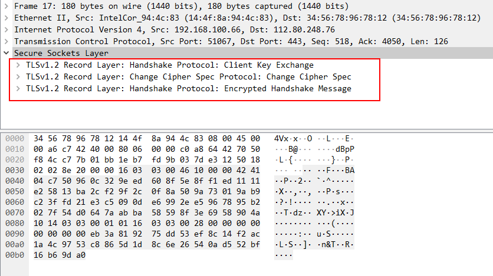
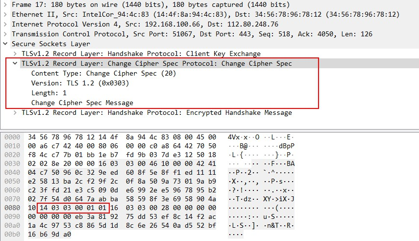
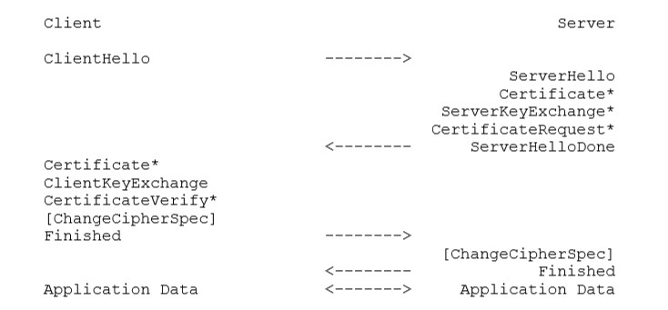
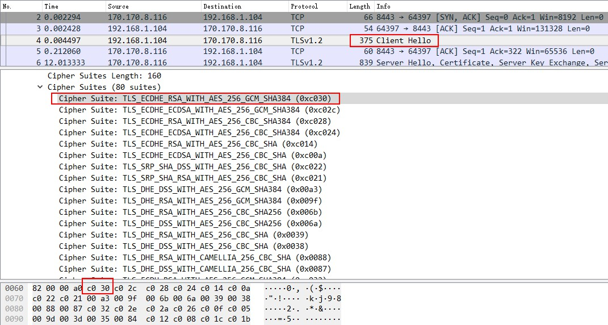
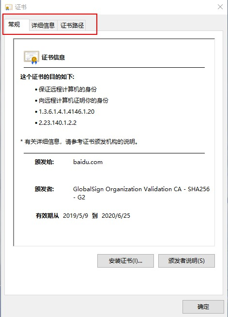
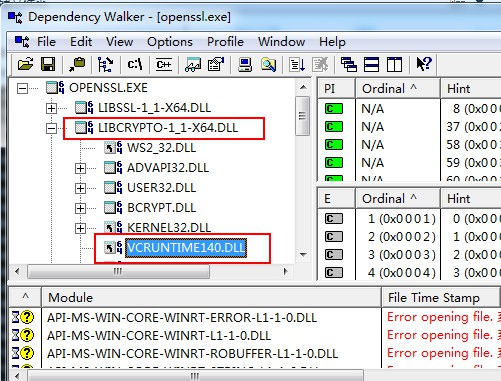

这是2019年左右学习TLS时写的一篇文章，以及附属的工具、示例、代码。

本项目介绍TLS的原理、使用方法、实现一个最简单的TLS协议、介绍几个TLS的漏洞。看完这个材料后，可以对TLS有个较为全面的认识了。

## 前言：SSL与TLS

SSL是安全套接字层（secure socket layer）的缩写，从名字上就可以看出，协议的设计者希望提供一个套接字API，能够安全地传输数据。SSL在1994年由网景公司推出，用在自家地网景浏览器上，后续IETF将SSL协议进行了标准化，并改名为TLS（传输层安全，transport layer security），于1999年推出了TLS1.0.这是第一个真正意义上地SSL/TLS标准。（TLS1.0之前还有一个SSL3.0，但是它并不是ietf标准，直到2011年，TLS1.2发布三年之后，才给SSL3.0“追授”了一个RFC 6101)。

SSL/TLS产生之时，正赶上互联网大发展，加之于其和HTTP天然的紧密联系，如今SSL/TLS已经在互联网世界中无处不在了。在web服务端，谷歌等公司很早就开始推行全站HTTPS，2015年起，国内的web服务业开始实行此策略；在客户端，chrome浏览器从2018年起，对未经TLS加密的站点标识为“不安全”；在协议规范层面，“未来”的HTTP 2.0将默认使用TLS。

SSL的早期版本SSL2.0现在已经无人使用，加之存在安全性上的缺陷，故RFC 6176规定禁止使用SSL 2.0。SSL 3.0对协议进行了大范围的改进，之后的TLS 1.0、TLS 1.1、TLS 1.2都是对协议的修修补补，这一段时间协议总体上保持了稳定。2018年底，IETF发布了TLS 1.3，这个版本对TLS进行了比较大的改进（甚至有人认为应该叫做TLS2.0）。附录A整理了这个版本RFC做出得改动和解决的问题。

在目前常见的加密通信协议中，SSH主要用在设备管理的场景，例如STelnet、SFTP、netconf等；IPSec则专注于VPN，TLS则因其产生于浏览器，加之与PKI的紧密结合，在面向用户的场景中大量使用。

企图浅浅地覆盖关于TLS的一切：

​		第一章从原理说起，结合报文聊一下SSL/TLS协议的思路；

​		在TLS中不可回避的一环就是证书，将在第二章介绍；

​		第三章将介绍如何使用OpenSSL，编译、编程等；

​		第四章实现了一个原始的TLS协议，通过此章可以详细了解TLS的主干；

​		第五章介绍了SSL/TLS历史上影响比较大的漏洞，读者可以了解到协议的漏洞是怎么一回事；

​		第六章，介绍TLS1.3

## 第一章：TLS原理 -- 以TLS1.2为例

### TLS概观

想要数据在不可信网络上安全的传输，对于HTTPS来说，其实是有三个需求：

* 我的通信内容不能被别人获取；

* 我的通信内容不能被别人篡改；

* 我需要验证通信对端的身份

SSL/TLS给出了一个解决方案：使用加密的办法来保证通信内容不被第三方获取，然后还可以在通信内容上附上HMAC（哈希信息校验码），来保证信息的完整性，从而避免被他人篡改；至于验证对端的身份，就使用数字证书来证明身份好了。

其实这就是SSL/TLS的主干了，很容已就掌握了不是么？大家认为很复杂的内容，其实都是对上述框架的填充和加固。我们后边即将提到的各种乱七八糟，无非都是这三句话的附属品而已。了解了这三句话，就抓住了这个协议的主干。

为了加密数据，需要将数据分段、压缩；为了保证完整性，需要通过各种方法提供校验，例如MTE、ETM、AEAD等等各种办法。而加密和校验完整性，都需要一个密钥，这就需要SSL握手来提供密钥协商机制，可能用到公钥密码算法、DH交换等等，这个过程还需要验证对端的身份，所以还要把证书那一套东西揉进来。。。现在我们已经有了一个课程列表了，等我们把这些七七八八学习一遍，就可以对SSL/TLS有一个立体的了解了。

### record 协议

SSL是个分层的协议，听起来好像很复杂，实际上没有那么什么。他的层叫record，record是SSL的基础数据单元，一个record承载了一个完整的SSL报文。record的作用很简单，就是为了将各种各样的SSL数据分隔开来，这样就可以很清楚地依次处理这些数据了。

record的结构也很简单，非常类似于TLV（type、length、value）的结构，他的字段有：

* Content Type：表示这个record承载的是什么类型的数据；
* Version：很简单，就是SSL版本
* Length：长度，就是这个record携带的payload的长度
* 后边剩下的Length个字节，就是record的负载了。

做过报文解析的同学都直到，有了TLV才能对报文展开解析，其实这就是record的全部作用了：将SSL的信息格式化，一个一个排列好，方便处理。

下边就是一个SSL报文的例子，这个网络报文包含了三个record：



展开第二个record，它长下边这个样子，这个record构成非常简单，短短6个字节而已，负载更是只有1个字节。



前边已经提过，SSL是个分层的协议，其实只有两侧，record是外层，record的负载就是内层协议，这才是真正有“密码意义”的数据。内层协议有四种：change cipher spec、alert、handshake、application data。

SSL通过handshake协议来进行协商，用于产生建立SSL连接所需的材料，然后change cipher spec协议，用于通知对端发送者将切换（加密）状态，application data中则承载了SSL加密的payload。而alert则用来发送错误消息。

其中application data是真正在传输应用数据，当然数据是加过密，并且进行了完整性保护。这块涉及的知识可能有分组加密的分组模式、加密和摘要的先后顺序（MTE、ETM、AEAD）、以及加密的填充等。这块的东西都比较细节，我们就不展开说了，只是在这里罗列一下名词，大家知道这里的相互关系即可，实在不知道也没关系。

但有一点是必须要知道，就是SSL对数据（包括但不限于application data）的加密，需要一个密钥，这个密钥的产生非常关键。实际上这个密钥是由SSL的hanhshake协议产生的。handshake协议负责协商协议的版本、算法和密钥材料，最终产生一个叫premaster secret的东西，这个东西在经过一顿眼花缭乱的操作最终产生了接受发送两个方向上的密钥。

ssl握手是建立连接的第一步也是最关键最复杂的一部，实现难度上是最大的，这也导致这个环节的安全漏洞较多，实际使用上的对接问题更不必说，因此我们在下一结专门介绍这块内容。至于密钥计算的细节，感兴趣的可以查看第四章。

### TLS握手协议：密钥配送问题

TLS握手主要是为了协商出版本、cipher suite(一般翻译做算法套件，也有的地方叫加密套件)以及一些选项，以及产生一个pre master secret。

对于版本、cipher suite和选项的协商，是通过握手协议的hello报文实现的。客户端首先发送clienthello报文，提供自己支持的最高版本号和支持的算法套件列表（按照自己的喜好排列），服务端会从中选取合适的版本号和自己中意的算法套件，并发送serverhello告知对方。至于扩展选项，一般说来是在clienthello的扩展字段中表明客户端希望能使用这个选项，服务器如果同意的话，在serverhello应答中也包含一下这个扩展即可。所以这些动作只是一个客户端提供选择然后服务器确认的过程，双方只需要一个round trip就可以协商一致。

pre master secret的协商比较复杂一点，这个密钥协商算法花样繁多，且步骤复杂，实际上这个环节对所有加密通信算法来说都是关键。

SSL/TLS可以支持多种密钥协商算法，其中比较典型的是DH密钥交换和RSA公钥加密。

#### DH密钥交换

DH就是Diffie-Hellman，是上世纪70年代提出的一种密钥交换算法，他利用一些巧妙的数学原理，双方只交换一些可以公开的“暗号”，就可以心领神会般地得到共享地秘密数字（密钥）。

纯粹地DH算法是不会进行身份认证的，因此无法抵御中间人攻击，实际使用时，通常使用带有认证的DH算法，具体的方法是在进行DH密钥交换的时候，服务器对DH参数和公钥进行签名（实际上还包含了client和server的随机数），这样Alice只要使用经过签名验证的参数进行DH计算，就一定是在和“意中人”协商。

无认证的DH密钥交换存在显而易见的安全问题，但SSL/TLS仍然允许这么做，这种密钥协商算法叫做DHE_anon，也就是匿名DH。

这样看来这些知识还是比较易懂的，但是我们模仿孔乙己问一个问题：Diffie-Hellman算法，有四种写法，你知道么？我们经常会在各种文献中看到DH、DHE、EDH、ECDH这些词，他们都带有DH字样，背后的概念存在联系又各不相同，他们都是什么意思？事实上，对这些术语的解释，要放到具体的语境上下文中去。

在一些场合（如SSL/TLS相关的RFC文本），DH与DHE都表示了带有认证的Diffie-Hellman算法。但又有区别。他们的区别在于由谁来进行密钥交换时的签名动作。“DH”表示服务器证书中已经包含了经过CA签名的DH参数，也就是说DH参数是服务器证书的一部分；而"DHE"则表示DH密钥需要临时产生，并且使用服务器证书的私钥进行签名。事实上，"DHE"的“E”并不是Exchange，而是Ephemeral，是“临时”的意思。

而EDH这个术语，从来没有在SSL/TLS的RFC中出现过，他是术语OpenSSL的术语，其实就是指的RFC中的DHE。在维基百科中，也将EDH和DHE视作同一个概念。

ECDH与上边三个都有所不同，是指Elliptic Curve Diffie-Hellman，椭圆曲线DH算法。这个算法与上边讲的DH算法数学原理完全不同，但是思路和形式与DH非常类似，所以也就有了类似的名字。与DH一样，ECDH家族也有一个“临时“ECDH，称作ECDHE。

另外，在指称密钥协商算法时，SSL/TLS的RFC使用了一套无歧义的表示方法：

* DH_RSA表示使用RSA认证，并且参数和密钥由证书提供的的算法；
* DHE_RSA表示使用RSA认证，并且参数和密钥由服务器产生的算法；
* DH_anon表示没有认证功能的那种Diffie-Hellman算法；
* ECDH系列也有符合上述规律，如ECDH_RSA、ECDHE_RSA、ECDH_anon。

命名整齐划一，爽死强迫症。其实真正的强迫症患者会纠结于他们的字符数目竟然不一样。。。。

#### RSA加密

RSA是一种非对称密码算法，这种算法可以用来进行密钥协商：Bob讲自己的证书（包含公钥）发给Alice，Alice可以产生一个pre master secret然后使用Bob的公钥加密发回去，世界上只有Bob的私钥能解开这段密文，因此实现了密钥的秘密配送。

强迫症患者又有问题了：DH由ephemeral的，那么RSA加密有这种东西么？

还真有ephemeral RSA key exchange这种东西。在这个机制里，Bob产生一个临时的RSA密钥对，然后使用自己证书的long-term密钥（就是证书的密钥）签名，送给Alice，Alice就使用这个临时公钥加密pre master secret然后发给Bob。这样似乎也能安全地完成密钥配送。

强迫症虽然得到满足，但是这一会儿long-term一会儿ephemeral，搞这么复杂有啥用呢？这实际上是”安全性“上的考虑，假设一下如果不适用ephemeral的方式：Alice使用Bob提供的公钥来加密pre master secret，而后Bob再解密，密钥配送之所以能安全地进行，是因为只有Bob拥有私钥。如果一旦Bob的私钥泄露，则这种机制不再安全，甚至在密钥泄露之前的通信内容也不在安全，这将是一个无法弥补无法接受的局面。这类算法的缺陷叫做缺乏”前向安全性（forward securcy）“，通俗的说就是，无法保证今天的秘密通信在将来也是安全的。

有了上边的举例，就不难理解为啥要有ephemeral了——即便long term私钥泄露了，攻击者仍然不能解密通信内容，long-term密钥只是用来做了签名而已，真正被用来保护秘密数字（pre master secret）的，是一个隶属于会话的临时密钥。攻击者即便获取了long-term私钥，也无法获取ephemeral的密钥，因此通信内容仍然是安全的。

从机制上，ephemeral是有他的好处的，但是在历史上，ephemeral RSA key exchange这种密钥协商算法的出现，并不是为了增强安全性，他是为了满足美帝的出口限制。RFC 2246中有关于出口的描述：如果Bob的longterm RSA密钥过长（512以上），则Bob必须提供给Alice一个较短的临时密钥来加密premaster secret，不支持使用长密钥做ephemeral key，这实际上降低了安全性。目前已经不再提这个出口限制，RFC524没有再提出口限制的事，也没有再定义临时RSA这种协议。

也正是因为这个原因，ephemeral RSA key exchange的代号不是”RSA“加字母”E“，而是"RSA_EXPORT".

####  性能的考虑

安全性上，通常只做一个定性的结论，例如”出口算法不安全“，”RSA密钥交换没有前向安全性“，”密钥长度小于多少则不安全“等等。

而网络性能上，则不同算法之间可以拿来比较，谁比谁更好或更差。一般说来，会考虑报文长度（占用带宽）、CPU使用率。

报文长度这方面，对于DH家族的算法相较于RSA，在协商过程中需要一个n/额外的server key exchange报文，这个报文用来告诉客户端DH参数。这块报文很小，只需要几百个字节，其实是没有特别大的影响的，而且在SSL的使用场景中，一般并不太在意SSL协商过程中会多一块数据。（但是如果从协议设计者的角度来考虑，这是不得不考虑的内容）。

另外不同算法需要的计算量也不相同。对于RSA密钥交换，需要的是客户端的1次RSA加密运算，和客户端的1次RSA解密运算。

而对于DHE，对于服务器而言，则需要：1、提供DH参数，2、生成DH公钥，3、对参数进行签名，4、进行DH计算。可见，对于服务端，DHE算法需要较多的计算量，SSL的实现可能会提供一些复用机制，从1、2这两个步骤进行性能增强（理论上第3步也可以复用），后续在第三章会以OpenSSL为例介绍下相关的API。

#### 握手过程

在这章，我们通过报文，来从外部观察SSL握手，在第四章提供了握手的代码，可以从内部视角来更加细致的了解。

下图就是TLS 1.2的握手完整过程了，其中*表示可选报文，可选报文和认证方式、客户端认证有关。



首先客户端发送一个ClientHello消息，服务端则响应一个ServerHello消息，这两个hello消息用来对齐安全能力，如协议版本、cipher suite等。

真正的密钥交换使用了最多四个消息：server certificate、serverkeyexchange、clientcertificate、client key exchange。在发送serverhello之后，服务器将其证书发送给客户端，然后是一个ServerKeyExchange消息，服务器还可以请求一下客户端的证书，然后服务器发送ServerHelloDone消息，表示hello消息发送完毕，然后等待客户端的响应。客户端会发送自己的证书（如果服务器这么要求的话），然后是ClientKeyExchange消息。根据以上的消息，双方都已经可以计算出pre master secret了，所以client发出ChangeCipherSpec报文，告诉对方”我要开始使用刚刚协商出来的密钥了“，然后发送一个加密的Finished消息，服务端也做出同样的回应，握手完成，

### cipher suite

SSL/TLS是一个框架，它规定了报文的格式、含义，并且在这个框架下搭配使用各种密码算法，实现保密的效果。既然是框架，就不会局限于特定的某一种密码算法，而是适应各种各样的要求，兼容并包了许许多多种算法。前文已经提到，SSL的两端要进行算法协商，就是为了让双方在算法选择上达成一致。

SSL/TLS有一个算法套件（cipher suite）的概念，有的地方也叫做密码套件。一个套件包含了一条会话所用到的所有密码学工具如密钥交换算法、加解密算法、分组方式、HMAC算法，可以理解位一个套餐，前菜主菜甜点都包含在里边。这点和ssh、IPSec不太一样，ssh、IPSec的各个环节的算法是分别协商的，只能分别单点，没有套餐。

算法套件的选择是开发和维护过程中经常遇到的问题点，很多兼容性问题、安全问题都与此有关。要了解它首先应该了解他的命名方式。按照RFC的定义，一个算法套件都是以SSL或TLS开头，紧跟着是密钥交换算法，然后是一个"WITH"，连接加解密算法、HMAC算法。以TLS_RSA_WITH_AES_128_CBC_SHA为例，来介绍这个名字的含义。

* ”RSA“表示密钥协商算法，这里是正儿八经的RSA，注意和RSA_EXPORT区别开；
* ”AES_128_CBC“是加解密算法，使用AES算法，密钥长度是128，CBC分组模式；
* "SHA"是HMAC算法，这里的SHA表示SHA1。

再举一个例子，TLS_DHE_RSA_WITH_AES_256_CBC_SHA256，这里的密钥交换使用ephemeral DH算法，并且参数由RSA算法来签名，使用AES加解密算法，并且其密钥长度是256bit，分组方式是CBC，HMAC算法使用SHA256。

以上是cipher suite在RFC的书面表达方式，还有一种常见的表述方式会在第三章介绍。在报文中，使用两个字节的ID来表示一个算法套件，例如在附件的”DHE密钥交换“抓包中的clienthello报文中，列出了客户端支持的cipher suite里欸表，如下图所示，使用0xC030来表示TLS_ECDHE_RSA_WITH_AES_256_GCM_SHA384，这是一个比较新的算法套件，2018年8月在RFC8422中定义。



cipher suite的名字已经给自己做了全面的”自我介绍“，然而在cipher suite协商过程中，还有很多”潜规则“，例如DH_RSA就需要证书中含有DH参数，并且使用RSA签名算法，并且证书的密钥用途中需要支持这么用，如果这些条件不满足，则不能使用这个算法套件。另外，算法套件还和SSL/TLS的版本号有联系，TLS1.2上能使用的，不一定能在TLS1.1上使用，反之亦然。

## 第二章：证书

当我第一次听说“数字证书”这个词的时候，我是完全没有概念的。之所以会出现这种情况，是因为第一我不知道证书用来干啥，第二我不知道证书的原理是啥，第三我也不知道证书长什么样子。

证书的原理其实很简单，就是公钥密码算法。使用公钥密码算法可以对一段文字进行签名，从而防止抵赖，证书就是这种功能的一个实际应用：通过第三方公正人员来证明证书持有者的身份。

至于证书可以干啥，我们这里只关注在SSL/TLS协议中的应用。

### 证书的字段

证书长什么样？它是一串数据，里边包含了非常精简的信息，证书文件的原始数据是非常难以读懂的，因此我们借助工具来对它进行解析并友好地展示出来。

在附录的packets路径下有一本百度的证书，使用OpenSSL工具可以解析并打印成易读的格式（这段数据比较长，完整的数据放在附录中）。然而总的来说只有两块：Data和Signature。

Data是一段声明信息，这段信息描述了证书的签发者是谁，颁发给谁，有效时间怎样以及其他各种各样的信息，然后呢，Signature是对这段信息的一个签名。就好比我们的毕业证书，Data就是说某同学在某学校如何如何，最后盖上学校的公章，公章就相当于数字证书的签名。

证书的细节非常繁杂，不需要全部关注，这里只挑选一些关键的字段来介绍其含义：

* Subject：中文名叫使用者，描述了证书使用者的一些基本信息。例如百度证书中这个字段是这样的“C = CN, ST = beijing, L = beijing, OU = service operation department, O = "Beijing Baidu Netcom Science Technology Co., Ltd", CN = baidu.com”，其含义是说使用者的Country是中国，state of residence（省份）是北京，位置是北京，Organization Unit是服务操作部门，Organization 是北京百度公司，最重要的是CN，CommonName，通用名称，是baidu.com
* Issuer：是指这本证书的签发者，用毕业证书来类比就是给毕业证书盖章的人。
* Key Usage：SSL/TLS中常用的是Digital Signature和Key Encipherment，详细的定义见RFC 3280。百度例子中这个字段后跟了一个“critical“，表示这个字段相当关键，如果你看到一本证书，然而不认识一个被标记为”critical“的字段，那就不要信任这个证书。
* SAN：Subject Alt Name，这也是很重要的一个字段，一本证书可以用在不同的域名上，那么证书上也要通过SAN字段声明这一点。
* Signature Algorithm：描述了这个证书是怎样被签名的，这对于验证证书签名的人来说非常关键。这个算法实际上包含了摘要和签名两个步骤。

如果使用window是操作系统自带的工具来查看证书，会更加友好一点。是下图这个样子。windows用三个页签来描述一本证书：常规、详细信息、证书路径。常规是一些最基本的信息，详细信息中就是Data字段，证书路径，就涉及下边我们要介绍的证书链。



### 证书链与PKI

暂时空缺。。。

### X509、ANS.1、DER、PEM

这块先挖个坑后边再来填吧

## 第三章：使用OpenSSL

在前两章中，我们已经粗略地介绍了SSL/TLS的原理。本章我们将从开发者的角度出发，学习怎样使用SSL/TLS，本文选取了一个可能是最知名的SSL/TLS协议实现——OpenSSL。

OpenSSL是一个开源的、全功能、商用级的密码算法和SSL/TLS协议库，遵从OpenSSL License（3.0.0之后的版本遵从Apache License V2）

### OpenSSL的版本

关于OpenSSL的版本号，在1.x.x版本中，有如下的承诺：

* 版本号最后一个字母的改变，意味着只有bug修正和安全问题修正，没有新特性；
* 最后一个数字的改变，例如1.1.1和1.1.0，则可能包含了新特性，但是不破坏二进制兼容性，这意味者升级库时无需编译应用软件，只需直接链接。应用软件无需重新编译，

当前OpenSSL的新版本是OpenSSL3.0.0，版本策略稍有变更，改成了MAJOR.MINOR.PATCH的形式，这种形式下，在同一个MAJOR版本下，API/ABI是一致的；

* MAJOR版本的变更表示API/ABI的变化；
* MINOR版本的变化，则表示有特性级的改变，但是API/ABI仍然是一致的；
* PATCH的变化则只表示修正bug。

当前OpenSSL在开发3.0.0版本，而1.0.2版本将在19年底EOS，1.1.0版本已经EOS，1.1.1将支持到2023年。

### 编译OpenSSL

在linux下的编译比较轻松愉快了，就是confiure、make、make install，没啥可说的。

windows下的编译，就比较麻烦。一种思路是使用minGW，还有一种就是Visual Studio。

####  MSYS2 + minGW

这个思路对选择困难症患者非常不友好，在环境选型得时候，mingw和mingw-w64傻傻分不清楚，msys和msys2左右为难。

mingw和mingw-64是两个大佬搞的源自同一套代码的两个分支（他们因为对64位得支持搞的分道扬镳），想分支也就算了，还起这么类似的名字，很容易搞混啊。MSYS和MSYS2也是类似的情况。。这里选取msys2和mingw-w64，因为我认为他们俩都更活跃一点，而且这俩是天生搭配的。

首先要准备msys2的编译环境，大致思路是：

1、安装一个msys2，官网上下载安装即可

2、在msys2中安装编译环境 pacman -S base-devel  mingw-w64-x86_64-toolchain（国外的源可能不好用，建议添加下国内的源）

3、设定gcc的环境变量

然后就是是：

，/Configure mingw64

make && make install

这块如果是第一次搞得话难免会忐忑，参考资料中有比较详细的指导，亲测好使。./openssl-1.1.1c-mingw-w64中就是我们用这个方法编译出的二进制文件。可以看到，OpenSSL代码的编译结果有三个：libssl实现了SSL协议，libcrypto则是一个密码算法库，openssl.exe是一个具有ssl和加解密功能的小工具。

顺便说一句，使用mingw（mingw-64），仍然需要代码支持windows平台，例如涉及socket的源代码，linux上要用sys/socket.h，在windows上（即使时mingw环境下）是没有这东西的，这时候你需要修改代码用windows的socket，或者干脆用cygwin。

#### Visual Studio

Visual Studio的编译工具叫nmake，它的用法和make差不多。

1、首先安装Visual Studio和perl

2、将nmake的路径加入环境变量，以我的例子来说是C:\Program Files (x86)\Microsoft Visual Studio\2017\Community\VC\Tools\MSVC\14.15.26726\bin\Hostx64\x64

3、打开一个cmd，调用vs提供的一个脚本来设置环境变量：C:\Program Files (x86)\Microsoft Visual Studio\2017\Community\VC\Auxiliary\Build\vcvars64.bat，然后cd到openssl路径下，perl Configure no-asm VC-WIN64A，然后nmake即可

由下图可以看到，库文件是会依赖vcruntime库的，这可能会造成用户需要单独安装这个库，如果静态链接的话，则会造成应用软件比较大。不过我觉得这个问题应该是可以解决的。



### 使用OpenSSL工具

在调试SSL的时候，OpenSSL工具是个不错的助手。

可以用它来做SSL的客户端或者服务端。作为服务端，其中-www表示服务端是一个以web服务器的方式响应请求：

 openssl.exe s_server -port 443 -cipher ALL -cert server.crt -key server.key -www

还可以做客户端：

openssl.exe s_client -connect x.x.x.x:443

一个常用的调试功能是做证书例如下边的命令做了一个三级的证书链：

~~~
.\openssl.exe genrsa -out root.key 2048

.\openssl.exe req -new -key root.key -out root.csr -config .\openssl.cnf

.\openssl.exe x509 -req -in root.csr -signkey root.key -out root.crt


.\openssl.exe genrsa -out intermediate.key 2048

.\openssl.exe req -new -key intermediate.key -out intermediate.csr -config .\openssl.cnf

.\openssl.exe x509 -req -CA root.crt -CAkey .\root.key -in .\intermediate.csr -out intermediate.crt -set_serial 01


.\openssl.exe genrsa -out server.key 2048

.\openssl.exe req -new -key server.key -out server.csr -config .\openssl.cnf

.\openssl.exe x509 -req -CA intermediate.crt -CAkey .\intermediate.key -in .\server.csr -out server.crt -set_serial 01
~~~

### 使用OpenSSL api：pyhon和c的例子

在openssl-example路径下，我们分别给出了python和c语言使用OpenSSL库实现SSL/TLS服务器和客户端的例程。其基本功能的实现，没啥好说的，一通百通。我们不再流水账般地啰嗦，只挑出部分有用的点单独讨论。

#### 选取DH参数

DH计算公式<I>y = g<sup>x</sup></I> mod<I>p</I> 中，<I>x</I>，<I>y</I>是密钥对，<I>p</I>和<I>g</I>就是说为的DH参数。

可以看到，DH算法需要设置的，也就是这个参数了。在SSL/TLS协议中，服务器需要指定DH参数，OpenSSL提供的设置DH参数的方式有两个：

在初始化CTX或者SSL会话的时候，可以设置DH参数SSL_CTX_set_tmp_dh(SSL_CTX *ctx, DH *dh)。需要说明的是，这个API会同时产生DH密钥对，并应用在CTX衍生出的所有会话上。这种行为对安全性是没有好处的（虽然截至目前还未出现针对这块的攻击），可以为CTX（或者SSL会话）设置SSL_OP_SINGLE_DH_USE选项，显式要求OpenSSL为每次DH运算都产生独立的密钥对（这并不会消耗太多的性能，但是可以解决安全问题，参考https://www.openssl.org/news/secadv/20160128.txt）。

另外一种方式就是设置回调函数，SSL_CTX_set_tmp_dh_callback为CTX注册一个回调函数，在SSL会话需要DH参数的时候，OpenSSL会主动回调该函数，向应用程序索取DH参数。这个回调最易错的地方在于回调函数的参数有迷惑性。这个回调原型是这样的：

```
DH *(*tmp_dh_callback)(SSL *ssl, int is_export, int keylength)
```

第一个参数很好理解，第二个参数表示该使用该DH算法的套件是否是出口算法，也不会有歧义，但是这个keylength常常被人们误解。事实上从OpenSSL使用回调的上下文代码来看，这个keylength参数只有两个取值，当算法套件是出口算法时，值为512，否则是1024.有些程序员这么写代码：

~~~
错误的代码示例：
DH *callback(SSL *ssl, int is_export, int keylength)
{
	switch(keylength):
	{
		case 512:
			return dh512();
		case 1024:
			return dh1024();
		default:
			return dh1024();
	}
}
~~~

首先，不能使用512和1024位的参数，这是存在已知安全漏洞的（log-jam），另外，不能使用keylength来作为选取DH参数的依据。后两个参数只是历史上出口算法相关的产物，不要在意它俩的存在，该用多长用多长。以上的逻辑在s3_srvr.c中的ssl3_send_server_key_exchange函数中体现。

#### 客户端认证问题

在大多数场景下，服务器会向客户端提供自己的证书，客户端却不需要出示自己的证书。但SSL同样提供一种机制，服务器在SSL握手时，主动请求客户端的证书，从而认证客户端的身份，这种互相认证的方式叫做双向认证。

具体说来，双向认证的步骤是（RFC 5246 7.4.6）：

1、在握手中，服务器可以通过发送certificate request报文来发起对客户端的认证：

2、客户端收到certificate request，要(MUST)发送一本证书回去，即使没有合适的证书也要发送一个空证书；

3、接下来服务器的行为是：

​	如果客户端发送了空的证书，服务器可以(MAY)选择继续握手或者发送handshake failure alert来终止协商；

​	如果客户端发送了一本证书，而这个证书不被服务器信任，服务器可以(MAY)选择继续握手或者终止协商。

可以说，服务器发出的certificate request是一个“提议”，客户端可以不配合，双方的行为都有选择地余地，后边我们会看到，这种宽松的规定能显著提高易用性。

以tomcat为例，其配置文件中可以设置SSLVerifyClient字段可以设置对客户端的认证要求。设置为“require”，表示需要双向认证，并且如果客户端没有证书或者证书校验不通过，服务器都会关掉连接。这种行为非常干脆，但是在客户端看来有点过于粗暴了，因为用户无法得知为什么服务端连接不上了，用户可能会感到茫然，认为服务不可用。

从用户的界面来看，一个比较友好的方式是，当用户没有证书或者证书有问题时，服务会自动跳转到特定的页面，在页面上指出用户的问题并给出操作指导。SSLVerifyClient设置为”optional“就可以解决这个问题。当客户端认证失败时，不是直接关闭连接，而是继续SSL会话，并且给用户重定向到一个特定的资源上，如下图所示。


#### 选择算法套件

在我看来，这个问题还挺棘手的，我在解决这类问题的时候，通常也感觉左右为难，很遗憾我无法给出完美的建议。

这个让我感到棘手的问题，实际上就是兼容性和安全性的冲突。从安全性上来看，随着攻击技术的进步，原本认为是安全的算法，可能变得不再安全，因此需要不断紧跟前沿，淘汰掉存在“潜在风险”的算法。而兼容性的观点则恰好于此相反，裁撤掉旧的算法将会给兼容性带来较大的风险，而且常常无法准确评估影响性，因此，从兼容性的角度来看，删掉任何一个算法套件，都是一个”艰难的决定“。

如果有什么建议的话，那就是在这种矛盾之间，选择符合”业界主流与趋势“的技术方案，应该有解决安全问题的勇气：

1、在开发过程中，第一次选取算法套件列表时，应该以安全为首要考虑，问题遗留到下游就会越来越棘手；

2、如果已经使用的算法出现了安全隐患，应该尽早积极应对。

3、例行及时升级库软件版本。

另外推荐一个不错的综合考虑安全性与兼容性的在线测试工具：https://www.ssllabs.com/ssltest/ 。该工具会检验SSL的配置检验安全性，并模拟各种终端进行访问从而找出具体的兼容性问题，并对表现进行打分。

## 第四章：动手实现TLS协议

### TLS RFC导读

如果你好奇TLS实现的细节，那么一定要RFC了。以TLS 1.2的RFC 5246为例，总共104页的英文文档，对许多同学来说还是有点难啃的。这一小节试图给这篇RFC做个简单的摘要，在大家决心啃这块骨头的时候，能够提供一点点帮助。

第一章简介，主要是一些特定表述的约定，例如MUST、MAY的准确含义；以及和上一个版本的差异。个人认为不用太关注。

第二章和第三章，是从比较高的角度来阐述TLS1.2的目的和作用。

第四章是一些密码学的术语的回顾。到这章为止，都还没有进入正题。

第五章突然话锋一转，定义了一个叫PRF的函数，这个函数用来产生master secret以及进一步产生加解密密钥、HMAC密钥等。此函数从结构上来说相当重要，但是也没有什么花头，一页纸写完。

第六章讲record协议，包括record的格式、以及怎样保护payload数据。其中就使用了PRF函数。

第七章讲了握手协议的细节。

第八章讲如何生成master secret。至此复杂的部分都已经讲完。

第九、十、十一、十二章的内容都很少，属于行文上必不可少但实质上内容不多。

然后就是几十页的附录，包括各个报文的定义、ciphersuite列表、一些协议实现上的细节要求、向后兼容的考虑、安全上的考虑等等。

总之，第五到八章能让你抓住协议的骨干，而第二、三章能让你像领导一样侃侃而谈，第一章和附录的部分章节能让你看起来像个知其所以然的专家。

### 实现一个TLS协议


## 第五章：TLS的漏洞举例

这一章选取了几个经典但是老旧的SSL漏洞，包括针对密码算法的攻击、对协议缺陷的攻击，但没有包括一些关于软件实现的漏洞，例如心脏滴血，它更多的是关于代码错误而非协议缺陷。

这章的内容可能看起来比较晦涩，但是我认为对部分同学是有用的。我做过一段软件维护工作，有时会遇到一些客户咨询关于SSL的漏洞，需要修补bug以及指导用户规避问题。当从原理上理解了漏洞的机制后，规避、修改的方法就比较灵活有效，反之手段就比较死板，甚至无计可施。也就是这个原因让我接触了关于SSL漏洞的内容，我想对大家有同样的意义。

### Bleinchenbacher padding oracle

#### 背景

Bleinchenbacher是一位瑞士密码学家，他在1998年公开了一种对RSA算法的碰撞攻击。这种攻击可以使攻击者获取SSL/TLS的premastersecret，从而计算出会话密钥，解密SSL流量。

这个攻击非常经典，开创了一种新的攻击模式（adaptive chosen ciphertext attack）。2018年公开的CVE-2017-17305(华为)、CVE-2018-0131（思科）表明，Bleinchenbacher padding oracle漏洞广泛存在于IKE协议的实现中。

#### RSA的延展性

延展性（malleability）是密码算法的一种性质。如果有一个算法，将一段明文<I>m</I>加密成密文<I>c</I>，对<I>c</I>经过特定处理后得到另外一段密文<I>c'</I>，而<I>c'</I>解密后的数据又和<I>m</I>具有某种对应关系，则这种密码算法具有延展性。

RSA就具有这样的性质：

<center><I>E(m)  = m<sup>e</sup></I> mod <I>n</I></center> 

<center><I>E(m) &middot; t<sup>e</sup> </I> mod <I>n</I> = <I>(mt)<sup>e</sup></I> mod <I>n</I> = <I>E(mt)</i></center>

也就是说，如果一个攻击者拿到一段密文<I>E(m)</I>，他不知道对应的明文<I>m</I>，但是他可以很容易构造出<I>m</I>的整数倍所对应的密文<I>E(mt)</I>。

举例来说，Alice为了从Bob那里购买一套商品，愿意支付100元，她将这个报价用RSA做了签名，委托Devil送给Bob，这时Devil就可以从中作梗，将报价篡改为200元。

#### RSA的填充

为了避免RSA的延展性被恶意利用，实际使用时RSA处理的消息都是经过填充的，这里讨论的漏洞，发生在叫做PKCS #1的填充方法中。

在PKCS #1中，要加密的数据<i>M</i>按照如下格式被填充成<I>m</I>（ || 代表字符拼接）：

<center><I>m</I> = 0x00 || 0x02 || [一些非0字节] || 0x00 + <I>M</I> </center>

且<I>m</I>的长度等于RSA的模数<I>n</I>的长度。

为了简便，设

<center><I>2B</I> = 0x00 + 0x02 + [剩余全是0x00]</center>

则符合填充的<I>m</I>的取值范围在<I>2B</I>和<I>3B</I>之间，也就是说，PKCS #1填充的数学含义是<I>2B <= m < 3B</I>。填充后，即使有攻击者构造出<I>E(mt)</I>，解密后的<I>mt</I>也大概率不会满足<I>2B <= mt < 3B</I>这个填充要求，因此解密者可以发现这个错误，从而识别攻击。

#### Bleinchenbacher padding oracle

有了PKCS #1这种填充，攻击者无法保证对每一个<I>t</I>都能构造出<I>E(mt)</I>，同时让<I>mt</I>合法。然而，对于一个特定的<I>t</I>值，仍然有一定概率使<I>mt</I>满足填充要求（<I>mt</I>大于<I>n</I>的时候需要取余）。这个概率的值小于<I>2<sup>-16</sup></I>,与RSA的密钥长度有关（解密后得到一个随机的序列，其高字节恰好是0x0002且后边存在一个0x00字节的概率）。

如果攻击者采用碰撞的方法，遍历各种<I>t</I>，构造出一系列的<I>E(mt)</I>去给Bob解密，并且他可以通过某种迹象判断<I>mt</I>是否符合PKCS#1 填充规范，则它又可以得到一个关于<I>m</I>的不等式：

<center><i>  2B <= mt </i>mod<i> n < 3B </i></center>

这个不等式缩小了<i>m</i>的取值范围，如果攻击者能得到多个这样的<I>t</I>，则可以不断逼近<i>m</i>的真实值，直到得到唯一的解，从而破解出<i>m</i>。

这就是Bleinchenbacher padding oracle的思路。剩下的一个关键点就在于攻击者怎样能够判断<I>mt</I>是否符合填充。在SSL/TLS使用RSA加密进行密钥协商的时候，客户端使用RSA将premastersecret加密组装成client key exchange报文发送到服务端，服务端会对这个client key exchange报文进行解密，在某些SSL/TLS实现中，如果服务端发现RSA解密后的数据不符合填充，则会做出与正常流程不同的行为，这个不同的行为一不小心泄露了<I>mt</I>的信息，给攻击者提供了判断依据。事实上，oracle这个词的意思就是“启示”。

#### 漏洞的修复

这个漏洞有两个关键点：算法层面的PKCS #1填充和协议层面的异常处理，这两个条件缺一不可。

SSL/TLS在协议层面规定了异常处理的流程，避免发出oracle。TLS1.0 rfc2246 7.4.7.1指出异常处理的原则，TLS1.1 rfc 4346 7.4.7.1 给出了更加具体的提示，到了tls1.2 干脆给了一个代码步骤，详细规定了这块的处理标准。是协议实现中，不仅要注意报文的行为，同样也应该关注侧信道是否会泄露信息。

在算法标准上，SSL/TLS没有做出改动，继续使用PKCS #1 V1.5。实际上OAEP方式的填充更加安全，它并不是单纯添加一些格式化的位，但也更加复杂，这里不表。

另外说一句，延展性并不总是有害的，在同态加密的场景中，这是一个优良的特性。

### CBC的缺陷：BEAST漏洞

#### BEAST往事

2011年9月，安全研究者Juliano Rizzo 和 Thai Duong在ekoparty安全大会上展示了BEAST攻击（Browser Exploit Against SSL/TLS. CVE-2011-3389），这是首次利用密码学弱点破解HTTPS流量，获得了广泛的关注。BEAST利用CBC分组的特性精心布置攻击场景，能够获取浏览器用户的敏感数据。

事实上，在BEAST漏洞披露的十年之前，业界就已经发现了它并且有了解决办法。这个前后顺序看起来比较矛盾，但是了解其中故事又觉得不足为怪。在密码学圈内，这个问题并不是新鲜事，很早之前就有人展开过研究，早在2002年OpenSSL就修补了这个问题，然而业界的厂商提供的修复方法并不统一，且都存在兼容性问题，加之业界普遍认为这种攻击非常难以利用，因此没有太大的风险。这种状态造成漏洞长久无法得到解决，直到2006年TLS 1.1发布，才从协议层面解决了这个问题。

从时间上看，本质上就是密码学者注意到了一个安全隐患，并且提出了多种解决办法，但都因为兼容性问题而无法落实，加之认为针对这个漏洞的攻击很难实施，因此长期搁置了这个问题，等到2006年才在新版本协议中修正它。2011年新的攻击思路出现，人们才真正意识到它的危险性，幸好此时TLS1.1 已经发布了5年，因此可以立即采取规避措施，否则情况会比较被动。但是SSL3.0和TLS1.0仍然受BEAST的威胁，在他们逐渐退出历史舞台之后，BEAST才被真正消除。

#### BEAST的思路

BEAST攻击需要同时利用中间人和客户端代码，需要精心布置攻击环境。它利用CBC分组模式本身的缺点，通过多次尝试，逐字节破解用户数据。

攻击的基础在于，CBC分组模式的IV是何可以预测的。在SSL3.0和TLS1.0使用CBC分组模式的cipher suite中，使用前一个block的密文作为下一个block的IV，即使密文跨越两个不同的record也同样遵顼这个规定。

Alice（被害客户端）同Bob（被害服务器）建立SSL连接，使用CBC分组方式，Alice想Bob发送了一个HTTP请求，其中包含了部分关键数据，例如cookie、口令等，这些数据在网络上以SSL密文的方式传输。假设在密文的第<i>i</i>个分组中，包含了Alice的关键数据，该分组对应的明文数据是<i>M<sub>i</sub></i>，密文是<i>C<sub>i</sub></i>，其IV是上一个分组的密文<i>C<sub>i-1</sub></i>，即<i>C<sub>i</sub> = E(M<sub>i</sub> &oplus; C<sub>i-1</sub>)</i> 

攻击者Devil可以瞎猜测这个<i>M<sub>i</sub></i>的值可能是<i>P</i>，如果 <i>C<sub>i</sub> = E(C<sub>i-1</sub> &oplus; P)</i> ，那么他的猜测就是正确的。为了验证这个等式是否成立，就必须掌握<i>E</i> ，也就是客户端发送数据的算法和密钥，而这个只有客户端能够掌握。

这里似乎走到了绝境，因为只有Alice才拥有密钥。但是我们先假设

如果Devil就是有能力让Alice在SSL连接中发送任意的应用数据，那Devil就可以证实自己的猜测，他可以构造这样一段数据：

<center><i>M<sub>j+1</sub> = C<sub>j</sub> &oplus; C<sub>i-1</sub> &oplus; P</i></center>

其中<i>C<sub>j</sub></i>是Alice已经发送出的最后一个block密文，同时也是即将发出的下一个block的IV。那么Alice最终发出的密文是 

<center><i>C<sub>j</sub> = E(C<sub>j</sub> &oplus; M<sub>j+1</sub>) = E(C<sub>j</sub> &oplus; C<sub>j</sub> &oplus; C<sub>i-1</sub> &oplus; P) = E(C<sub>i-1</sub> &oplus; P) </i></center> 

注意等式的右边，这正是攻击者想看到的，前文已述如果等式<i>C<sub>i</sub> = E(C<sub>i-1</sub> &oplus; P)</i> 成立，即可断定<i>P = M<sub>i</sub></i>，现在又向前接近了一步，只需要判定<i>C<sub>j</sub> = C<sub>j</sub></i> ，而这个等式是很容易判断真伪的。

也就是说，攻击者猜测一段明文，并且能让Alice发送一段与这个明文有关的一段数据，就能判断Alice之前发送的一段数据是否符合攻击者的猜测。

攻击思路似乎有了点眉目，但是仍然有两个问题：首先大部分加密算法的分组都还挺大的，常用的AES是128比特，虽然攻击者可以验证自己的猜测是否正确，但是在<i>2<sup>128</sup></i>这么大一个定义域内猜测，是很难蒙对的。另外，怎么才能让Alice按攻击者的意图来发送数据？

对于第一个问题，可以通过挪动敏感数据的位置来实现。例如下边这个HTTP请求：

~~~
GET /XXX HTTP/1.0
Cookie:JSESSIONID=0123456789
~~~

如果我们能控制Alice发出的请求，就可以调整JSESSIONID之前的内容，例如起始行中的路径或者一些不太关键的头部，让JSESSIONID的值的第一个字节刚好落到第<i>i</i>个block的最后一个字节，这样在这个包含了一个字节敏感数据的分组中，只有最后一个字节是不确定的，攻击者最多需要猜256次就肯定能破解出这个字节，考虑到HTTP是个文本协议，这个分组的定义域就更小了，可以很快碰撞出来。看来这一个问题的解还是要依赖于如何让Alice发送特定的数据。

 对于第二个问题，漏洞研究者给出了一个场景，就是Alice同时在访问另外一个网站mallory.com，而mallory.com上包含了恶意的代码，可以接收中间人捕获的报文，并迫使Alice的浏览器在SSL隧道中发送特定的报文。这当然受同源策略的管控，作者列出了几种可行的方法，包括HTML5 WebSocket API，Java URLConnetion API， and Silverlight WebClient API。总之这些API可以任意调整URL的长度从而移动蜜柑数据的位置，并且可以在SSL隧道中发送二进制的数据，并且对应的block是record中的第一个block。

#### 业界的应对措施：混乱与困境

##### OpenSSL

OpenSSL早在2002年的0.9.6版本就修复了这个问题，OpenSSL采用的方法被称作0/n，就是在发送应用数据之前，首先发送一个空的record，则真正数据加密使用的IV是前一个空record的密文。那么这个IV是不能在上次发送数据后就预测出来，从而攻击者无法计算出<i>M<sub>j+1</sub></I>，从而无法实施攻击。然而一些其他的SSL的实现却不兼容这种插入空record的做法，例如IE浏览器。OpenSSL指责IE有bug，然而这并不能解决问题。最终OpenSSL将这种插入空record的措施做成了一个选项（SSL_OP_DONT_INSERT_EMPTY_FRAGMENTS），并且默认不开启这个规避措施。这样的解决措施，在现网很难使用。

##### 微软

微软在2011年9月发文称这是业界共同问题，但是影响有限。建议如果谁认为自己受到这个漏洞的威胁，可以使用TLS1.1或者TLS1.2。

但是微软还是在12年初发布了MS12-006解决此问题。不同于OpenSSL，微软使用了1 /(n-1) 的修改方式。在发送应用数据时，先发送只加密了一个字节明文数据的record，然后再正常发送其他的数据。这种方式比较巧妙，如果报文中发送了一个字节的应用数据，那么根据GenericBlockCIpher的结构，MAC也会被当作block中的数据，而MAC中有sequence number，而应用层无法控制这个数据，因此避免了BEAST。

然而后来证明这种方式仍然存在兼容性问题。

##### Chrome

chrome再2011年9月从多个方面研究了解决办法，似乎效果都不够好：

​	1) OpenSSL 采用0/n方式，chrome做了实验，在当时的互联网环境中仍然有很多不兼容的情况，因此不建议这种做法。

​	2) 采用TLS1.1和TLS1.2，TLS1.1已经在2006年发布，但是要广泛使用并完全替代SSL3.0和TLS1.0，还需要很长一段时间，因此不能完全放弃老版本的协议。

​	3)要实现BEAST，需要在浏览器上运行代码。chrome已经默认禁用了java，但是其他的技术仍然可以在浏览器中执行代码。

​	4）1/(n-1)的方法，这个与微软的方法一样，chrome正在测试，不知后续是否使用。

##### 问题的解决

上边的几个厂商，似乎都很乏力，没有完美的解决办法。这是个协议的漏洞，还是要在协议层面解决。

从TLS1.1 还是，通过explicit IV机制解决了这个问题（RFC4346 6.2.3.2）。RFC首先澄清了几个概念，IV、CBC residue、mask。RFC认为问题的本质在于使用前一个record的CBC residue作为下一个record的IV（mask），这种机制造成了BEAST。因此他们的修正方式是：在每个record密文的开始增加一个block的数据，这段数据不会被当成真正的应用数据，只是为了使加密数据使用的mask不会通过之前的record预测，mask不可预测，就取消了攻击的可能性。


### SSL机制：无中生有的重协商

CVE-2009-3555描述了一种中间人攻击，能够巧妙利用SSL重协商机制的缺陷，在用户会话中插入数据。这又是一个协议层面的问题，影响到了诸多厂商。

与BEAST不同的是，这个漏洞并不涉及密码算法，只涉及SSL的状态切换

#### 攻击过程

这个攻击非常巧妙，需要中间人的条件，步骤如下：

1）中间人扣押客户端发送的client hello；

2）中间人与服务器建立SSL连接，在SSL隧道中发送一段构造的数据，是一个不完整的HTTP请求；

3）中间人将扣押的clienthello报文放在协商好的SSL隧道中，发给服务器，这样在服务器看来，对端发起了一次重协商，服务器将协商进行下去；

4）客户端看到服务器接受了自己的请求，于是继续与服务器握手。此时中间人只管将报文加解封装

5）完成协商后，服务器发送了一个HTTP请求，并且带有自己的cookie。

如果第二步里中间人发送的请求是：

~~~
GET /PATH/dosomething.jsp HTTP/1.1
X-ignore:
~~~

而客户端发出的请求是：

~~~
GET /index.jsp HTTP/1.1
Cookie:JSESSIONID=0123456789
~~~

则服务器看到的请求是：

~~~
GET /PATH/dosomething.jsp HTTP/1.1
X-ignore:GET /index.jsp HTTP/1.1
Cookie:JSESSIONID=0123456789
~~~

这就伪造了一个请求。

#### 安全重协商

2010年IETF发布RFC 5746 Renegotion Indication Extension来解决这个问题。具体办法是增加“secure renegotiation”机制。这种机制要求在client hello和server hello中增加一个renegotiation info扩展。其思想是，重协商的时候，hello报文的renegotiation info扩展要带有上次协商完成的finish报文给对端校验。

但这种方法毕竟是一个hello extension，对端可能会不支持这个扩展，有些SSL实现甚至会因为不认识扩展而关闭连接。因此不得不再增加一个TLS_EMPTY_RENEGOTIATION_INFO_SCSV，与renegotiation info extension一起做为法安全重协商的标记（但是RFC并不推荐clienthello中同时使用这两个标记）。另外RFC还不厌其烦得规定在各个场景下兼容性问题得处理办法。总之，这套机制乍看上去并不是很干净利落，但是碰上兼容性这档子事情，也无可奈何。

## TLS1.3


## 参考资料

DHE与EDH：http://openssl.6102.n7.nabble.com/EDH-vs-DHE-which-specifications-use-the-term-quot-EDH-quot-td47752.html

推荐的windows环境OpenSSL工具下载：https://bintray.com/vszakats/generic/openssl

证书字段介绍：https://knowledge.digicert.com/solution/SO18140.html

mingw编译OpenSSL：https://wiki.qt.io/Compiling_OpenSSL_with_MinGW

配置清华MSYS2镜像：https://mirror.tuna.tsinghua.edu.cn/help/msys2/

apache中配置用户友好的双向认证：https://blog.ryandlane.com/2010/07/29/requiring-ssl-client-authentication-in-a-user-friendly-way-in-apache/

Bleichenbacher论文：http://archiv.infsec.ethz.ch/education/fs08/secsem/Bleichenbacher98.pdf

2018年usenix大会论文，IKE上的Bleichenbacher padding oracle：https://www.usenix.org/SYSTEM/files/conference/usenixsecurity18/sec18-felsch.pdf

BEAST 研究者论文：https://bug665814.bmoattachments.org/attachment.cgi?id=540839

OpenSSL在2002年修复BEAST:https://www.openssl.org/~bodo/tls-cbc.txt

微软SA:https://msrc-blog.microsoft.com/2011/09/26/microsoft-releases-security-advisory-2588513/

1/(n-1)的修改方法：https://bugzilla.mozilla.org/show_bug.cgi?id=665814#c59

1/(n-1)仍然存在兼容性问题：

RFC草案，废除TLS1.0和TLS1.1：https://tools.ietf.org/html/draft-ietf-tls-oldversions-deprecate-05


## 附录 

### A 证书举例：百度的证书


```
PS C:\Users\xxx\Desktop\tls> .\openssl-1.1.1d-win64-mingw\openssl.exe x509 -in .\packets\baidu.cer -inform DER -noout -text
Certificate:
    Data:
        Version: 3 (0x2)
        Serial Number:
            2c:ee:19:3c:18:82:78:ea:3e:43:75:73
        Signature Algorithm: sha256WithRSAEncryption
        Issuer: C = BE, O = GlobalSign nv-sa, CN = GlobalSign Organization Validation CA - SHA256 - G2
        Validity
            Not Before: May  9 01:22:02 2019 GMT
            Not After : Jun 25 05:31:02 2020 GMT
        Subject: C = CN, ST = beijing, L = beijing, OU = service operation department, O = "Beijing Baidu Netcom Science Technology Co., Ltd", CN = baidu.com
        Subject Public Key Info:
            Public Key Algorithm: rsaEncryption
                RSA Public-Key: (2048 bit)
                Modulus:
                    00:b4:c6:bf:da:53:20:0f:ea:40:f3:b8:52:17:66:
                    3b:36:01:8d:12:b4:99:0d:d3:9b:6c:18:53:b1:19:
                    08:b0:fa:73:47:3e:0d:3a:79:62:78:61:2e:54:3c:
                    49:7c:56:da:c0:be:61:55:d5:42:70:6a:10:be:f5:
                    bd:8d:64:96:21:00:93:63:09:87:b7:19:ba:0e:20:
                    3e:49:c8:53:ed:02:8f:46:01:eb:a1:07:93:73:bb:
                    ed:f1:b3:c9:e2:fb:dd:f0:39:2a:83:ad:f4:41:98:
                    bc:86:ea:ba:74:a8:a6:e3:d0:e5:c5:8e:b3:0b:b2:
                    d2:ac:91:74:0e:ff:80:10:23:36:62:65:08:b4:87:
                    f5:57:0c:25:c7:00:d8:f5:a8:5d:b8:33:41:a7:2a:
                    5f:db:fa:70:9e:21:bb:ae:42:16:66:07:69:fe:1c:
                    26:2a:81:0f:ab:73:e3:d6:52:20:a4:6d:a8:6c:d4:
                    66:48:a4:6f:f2:68:0a:c5:65:a1:4e:bf:04:7a:40:
                    43:1c:d3:75:fb:75:ac:19:d6:4a:35:05:6e:cf:d5:
                    65:d1:44:ca:6b:0c:58:04:c4:85:4f:1f:be:2c:32:
                    d1:f1:c6:28:fb:f9:26:36:b5:6d:fa:cb:96:a2:a0:
                    d0:bc:f8:51:df:07:44:bd:8f:6f:67:c0:d4:af:d9:
                    cd:c3
                Exponent: 65537 (0x10001)
        X509v3 extensions:
            X509v3 Key Usage: critical
                Digital Signature, Key Encipherment
            Authority Information Access:
                CA Issuers - URI:http://secure.globalsign.com/cacert/gsorganizationvalsha2g2r1.crt
                OCSP - URI:http://ocsp2.globalsign.com/gsorganizationvalsha2g2

            X509v3 Certificate Policies:
                Policy: 1.3.6.1.4.1.4146.1.20
                  CPS: https://www.globalsign.com/repository/
                Policy: 2.23.140.1.2.2

            X509v3 Basic Constraints:
                CA:FALSE
            X509v3 CRL Distribution Points:

                Full Name:
                  URI:http://crl.globalsign.com/gs/gsorganizationvalsha2g2.crl

            X509v3 Subject Alternative Name:
                DNS:baidu.com, DNS:click.hm.baidu.com, DNS:cm.pos.baidu.com, DNS:log.hm.baidu.com, DNS:update.pan.baidu.com, DNS:wn.pos.baidu.com, DNS:*.91.com, DNS:*.aipage.cn, DNS:*.aipage.com, DNS:*.apollo.auto, DNS:*.baidu.com, DNS:*.baidubce.com, DNS:*.baiducontent.com, DNS:*.baidupcs.com, DNS:*.baidustatic.com, DNS:*.baifae.com, DNS:*.baifubao.com, DNS:*.bce.baidu.com, DNS:*.bcehost.com, DNS:*.bdimg.com, DNS:*.bdstatic.com, DNS:*.bdtjrcv.com, DNS:*.bj.baidubce.com, DNS:*.chuanke.com, DNS:*.dlnel.com, DNS:*.dlnel.org, DNS:*.dueros.baidu.com, DNS:*.eyun.baidu.com, DNS:*.fanyi.baidu.com, DNS:*.gz.baidubce.com, DNS:*.hao123.baidu.com, DNS:*.hao123.com, DNS:*.hao222.com, DNS:*.im.baidu.com, DNS:*.map.baidu.com, DNS:*.mbd.baidu.com, DNS:*.mipcdn.com, DNS:*.news.baidu.com, DNS:*.nuomi.com, DNS:*.safe.baidu.com, DNS:*.smartapps.cn, DNS:*.ssl2.duapps.com, DNS:*.su.baidu.com, DNS:*.trustgo.com, DNS:*.xueshu.baidu.com, DNS:apollo.auto, DNS:baifae.com, DNS:baifubao.com, DNS:dwz.cn, DNS:mct.y.nuomi.com, DNS:www.baidu.cn, DNS:www.baidu.com.cn
            X509v3 Extended Key Usage:
                TLS Web Server Authentication, TLS Web Client Authentication
            X509v3 Subject Key Identifier:
                76:B5:E6:D6:49:F8:F8:36:EA:75:A9:6D:5E:4D:55:5B:37:5C:FD:C7
            X509v3 Authority Key Identifier:
                keyid:96:DE:61:F1:BD:1C:16:29:53:1C:C0:CC:7D:3B:83:00:40:E6:1A:7C

            CT Precertificate SCTs:
                Signed Certificate Timestamp:
                    Version   : v1 (0x0)
                    Log ID    : BB:D9:DF:BC:1F:8A:71:B5:93:94:23:97:AA:92:7B:47:
                                38:57:95:0A:AB:52:E8:1A:90:96:64:36:8E:1E:D1:85
                    Timestamp : May  9 01:22:04.826 2019 GMT
                    Extensions: none
                    Signature : ecdsa-with-SHA256
                                30:45:02:20:2C:7B:4D:C0:F9:85:47:8A:2D:0A:C0:79:
                                3B:D6:B4:B5:66:F8:AA:FB:82:58:AD:23:36:FE:16:BC:
                                A6:83:99:21:02:21:00:C0:2F:CD:9C:99:20:CB:7D:91:
                                5F:D2:8B:C6:13:10:73:B5:C1:54:03:33:41:9F:A6:6A:
                                C5:14:93:CF:69:2B:6B
                Signed Certificate Timestamp:
                    Version   : v1 (0x0)
                    Log ID    : 6F:53:76:AC:31:F0:31:19:D8:99:00:A4:51:15:FF:77:
                                15:1C:11:D9:02:C1:00:29:06:8D:B2:08:9A:37:D9:13
                    Timestamp : May  9 01:22:03.983 2019 GMT
                    Extensions: none
                    Signature : ecdsa-with-SHA256
                                30:45:02:20:03:32:68:9E:39:D0:EB:5F:19:61:DB:A7:
                                12:69:6F:28:44:81:02:A5:3C:C2:A3:13:D5:7E:98:26:
                                5F:20:1A:A0:02:21:00:A7:8B:62:B3:B0:B4:44:32:E2:
                                11:FF:45:8D:55:11:2C:36:AB:29:93:44:C8:34:5C:CE:
                                7C:35:57:31:AE:AB:12
    Signature Algorithm: sha256WithRSAEncryption
         aa:b9:cd:52:8e:dc:36:5d:47:d4:8b:f3:32:17:06:46:83:60:
         a3:27:05:49:29:b1:1b:46:6e:38:fe:93:fe:09:43:6c:d2:a1:
         58:24:12:42:b7:ab:41:f8:47:0a:7d:64:b5:75:dc:5a:45:14:
         b2:a4:18:6b:9c:b7:3b:8f:b3:7e:d2:bd:c0:72:4b:35:05:ae:
         0d:2d:19:1f:50:73:72:5a:df:97:18:3b:db:2a:f3:de:44:ce:
         64:2d:c1:1e:84:cc:76:24:3e:30:67:23:26:e8:4f:f7:0b:f6:
         ec:69:d7:7f:51:a9:a0:6f:b8:c4:14:e2:c0:4a:4a:c4:00:5d:
         57:6a:c9:41:c4:25:2b:32:18:aa:62:a8:1e:49:81:73:1c:81:
         5f:5e:fa:e4:94:32:c3:50:6d:8e:aa:cc:6c:4c:53:0c:fa:8f:
         4e:34:79:9f:a5:60:c0:f8:50:75:b8:a1:9d:01:e6:ab:25:23:
         0c:3b:24:02:40:58:24:ff:34:02:8b:94:61:10:68:2f:b6:80:
         e3:d0:5f:4a:0a:a7:02:d2:c0:98:3e:1d:e8:02:c8:27:71:26:
         b2:a8:87:b6:db:9d:10:47:4b:c2:13:62:34:c6:d0:3c:39:09:
         39:25:8f:fe:a2:f4:f3:fb:df:9b:27:3d:fc:d0:28:e8:6d:dc:
         dd:17:d3:1f
PS C:\Users\xxx\Desktop\tls>
```


